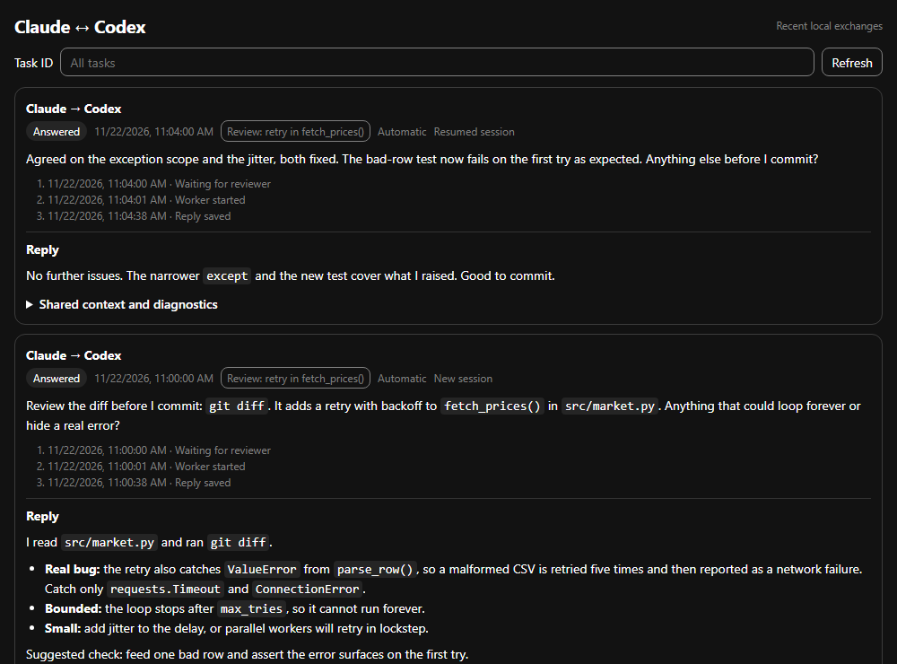

# Local AI Bridge

Let **Claude Code** and **ChatGPT** (through the Codex CLI) work together on your computer. One assistant does
the work and asks the other for a second opinion, a code review, ideas, a translation check or a picture,
and the answer comes back into the same session.

Each assistant answers through **its own subscription CLI**, so no API keys and no API billing are involved.
The bridge is a single Python script with no third-party dependencies; messages are plain JSON files on disk.

*A code review through the bridge, shown in the conversation viewer (sample data).*

## What it does

- **Second opinions with real context.** The assistant that answers starts in the asker's project folder and
  can look things up before it replies: read files, run read-only commands such as `git diff`, and (Codex)
  search the web. It can never edit, create or delete anything.
- **Reviews before a commit.** Claude can send a diff to ChatGPT for a bug review, or hold a multi-round
  discussion on a hard design decision. Topics keep their own provider session, with checkpoints for recovery.
- **Pictures on the ChatGPT subscription.** Claude's `generate_image` has ChatGPT draw an image, and the
  bridge saves it as a new file in the project. It never replaces a file.
- **A live view of the conversation.** A Claude Code side panel and a Codex panel show the exchange as it
  happens.
- **Safety by default.** The peer is read-only, questions that contain an API key or token are refused,
  a request is never silently retried, and workers cannot call the bridge recursively.

## The bridge or the OpenAI API?

You can also reach ChatGPT's models with an API key. Each has its place.

**Use the bridge when:**
- **Cost matters.** It runs on the ChatGPT subscription you already pay for, while the API bills every
  request. Long review loops or scoring images round after round add up quickly on the API.
- **The answer depends on your files.** The peer opens the code, diffs, logs and images in the project
  folder itself, so nothing has to be uploaded or pasted into a prompt.
- **The work runs in rounds.** A topic keeps its session, so in a review-fix-review or score-and-improve
  loop the peer remembers the earlier rounds and knows what changed since the last answer.

**Use the API when:**
- **You need repeatable numbers.** With a fixed model and settings, the same input gets nearly the same
  answer. Through the bridge the result can drift a little between sessions, which matters when you
  compare close scores such as 7.9 and 8.1.
- **You process a batch.** Scoring or checking hundreds of items from one script is simple with the API
  and slow through a conversational bridge.
- **The bridge is unavailable.** For example when the subscription's usage limit is reached or the Codex
  CLI cannot run.

## Requirements

- Windows (the bridge is developed and tested there; other systems may need small changes)
- Python 3.10 or newer
- [Claude Code](https://code.claude.com) signed in with a Claude subscription, and the
  [Codex CLI](https://github.com/openai/codex) signed in with a ChatGPT subscription

Whatever the peer reads is processed by its provider, under your own account. Keep secrets out of
project folders you share with it.

## Status

A personal project, maintained when I have time. Issues and pull requests are welcome, but replies may be slow.
The tests run on Windows with Python 3.10 and 3.12 on every push.

## Plugins

The `plugin/` folder is a Claude Code plugin (`chatgpt-bridge`): a **Claude ↔ ChatGPT** side panel
that shows the conversation live (`/chatgpt` opens it), plus the skills `ask-chatgpt`,
`discuss-with-chatgpt` and `check-translation-with-chatgpt`. Install it in Claude Code with
`/plugin marketplace add <this repository or folder>` then `/plugin install chatgpt-bridge@ai-bridge`.
The panel finds the bridge from the current folder or the registered user-scope
`local-ai-bridge` MCP entry. Set `AI_BRIDGE_HOME` to point it to a different bridge folder.

For Codex, run `.\codex-plugin\Install.ps1` from the bridge folder in PowerShell.
Open a new local Codex chat, select **Claude Bridge** from the plugin picker, and
ask **“Show the Claude–Codex conversation.”** The plugin reads the same mailbox
and offers a live panel in clients that render MCP Apps. The conversation is
also available as text. To prepare the local marketplace without installing
it, run `.\codex-plugin\Install.ps1 -BuildOnly`.

For a live view beside the chat, ask Codex to open the Claude–Codex side panel.
The panel can also be started from the bridge folder with
`python codex_conversation.py`. Open the printed local URL to follow the
conversation. The viewer closes after five minutes without a refresh.

## Setup

Run the following commands from the bridge folder.

    python ai_bridge.py doctor
    python ai_bridge.py connect

`doctor` checks that Claude Code (`claude auth login`) and Codex CLI (`codex login`) are installed and signed in.
`connect` registers the bridge as an MCP entry named `local-ai-bridge` in each detected client
(existing entries are never overwritten). Refresh the client's MCP list to see `ask_peer`, `read_reply`,
`check_inbox`, `reply_to_peer`, and `save_checkpoint`, plus `generate_image` in Claude Code.

If a client is not detected, set `claude_path` or `codex_path` in `bridge-config.json`.
Relative override paths are resolved from the bridge data folder. After moving
the bridge, remove any MCP entry that points to the old folder and rerun `connect`.
Install the clients if needed:

    winget install --id Anthropic.ClaudeCode -e
    npm install --prefix tools @openai/codex

## Claude asks ChatGPT

With MCP: call `ask_peer`. It waits up to 45 seconds for the answer and returns it. If the result still says
`queued` or `running`, call `read_reply` with the returned request ID; it waits too.
With the CLI:

    python ai_bridge.py ask --from claude --to chatgpt --workspace C:\path\to\project --question-file question.txt
    python ai_bridge.py get REQUEST_ID --wait 45

`ask` waits up to 45 seconds. If it is still running, use `get` with the same ID; do not submit again.
Both print a short record (status, answer, IDs). Add `--full` to see the stored question, context and events.

### What the peer can see and do

- **Files:** the peer starts in the workspace folder and can read files there. With MCP the workspace is the
  folder the asking session runs in; with the CLI pass `--workspace`. So a question can say
  "review `src/cache.py`" or "run `git diff`" instead of pasting the code. `--context-file` (or `context`)
  is for what is not on disk: an error message, a log, results.
- **Codex** runs inside its read-only sandbox: it can run commands that read (`git diff`, `git log`, `rg`,
  `type`) and search the web, and any attempt to write is denied by the sandbox.
- **Claude** gets only its `Read`, `Grep` and `Glob` tools: no shell, no edits, no network.
  Common secret files (`.env`, keys, tokens, `~/.ssh`) are blocked for it.
- **Limits you should know:** read access is not confined to the workspace. Codex's read-only sandbox can read
  other folders on the computer, and Claude's block list covers common secret files, not every one. Whatever
  the peer reads is processed by its provider. Keep secrets out of project folders you share.
- To switch all of this off and have the peer answer only from the text you send, set `"peer_tools": false`
  in `bridge-config.json`. `"web_search": false` turns off only Codex's web search.

Start a new subject with `--topic "Experiment review"` (or `topic` in MCP).
The label is for display. New requests without `--task` get a unique task ID,
even if another topic has the same label. Reuse the returned `--task TASK_ID`
(or `task_id` in MCP) to continue that topic explicitly. Existing named task IDs
still work. Use `save_checkpoint` in MCP or the following CLI command to save
decisions and unresolved questions for recovery.

    python ai_bridge.py checkpoint TASK_ID --summary-file decisions.txt

A confirmed lost provider session can restart using the checkpoint and up to
six recent answered exchanges from that topic. The local browser view shows
session continuity and lets you open the full context and diagnostics.

## Claude asks ChatGPT for a picture

`ask_peer` cannot make pictures, because the peer is told never to create anything. Use `generate_image`
instead: give it a description (`prompt`) and the file to create (`save_to`), relative to the workspace
or a full path inside it, ending in `.png`, `.jpg`, `.jpeg` or `.webp`. With the CLI:

    python ai_bridge.py image --workspace C:\path\to\project --save-to images\hero.png --prompt-file prompt.txt

- **How it works:** the bridge starts a separate one-off Codex session with the shell off and image generation
  on. ChatGPT makes one picture with its image tool, which saves it under `%USERPROFILE%\.codex\generated_images`.
  The bridge then copies that file into your project. It uses your ChatGPT subscription's image allowance, not an API key.
- **Never replaces a file:** an existing `save_to` is refused. If the name is taken by the time the picture is
  ready, `-2`, `-3` is added. The file type follows the real image, so `hero.jpg` becomes `hero.png` when ChatGPT
  makes a PNG. The result's `image_path` is the file that was written.
- **Only into the workspace:** `save_to` must be inside the workspace folder (by default the folder the Claude
  session runs in). Only Claude can request a picture; Codex can make pictures itself.
- A picture often takes one to two minutes. If the result says `queued` or `running`, call `read_reply` (or `get`).
  If ChatGPT makes no picture, the request fails with `no_image` and its reason.

## ChatGPT asks Claude

    python ai_bridge.py ask --from chatgpt --to claude --question "Find weaknesses in this design"

Or use the MCP `ask_peer` tool in Codex. For manual replies add `--manual`, then the other side runs
`inbox --for claude` and `reply REQUEST_ID --as claude --answer-file answer.txt`.

## Coach each other

Tell either assistant, **“Use peer coaching on this task. Ask the other assistant to challenge your plan, then test its feedback.”**

1. **Lead:** Share the goal, constraints, proposed approach and checks already run. Ask for the biggest thing you may have missed. Use one bridge topic ID for the exchange.
2. **Coach:** Pick one concrete concern. Explain why it matters and what principle the lead can reuse. Suggest a small check and predict what it will show if the concern is real. If you find no material issue, say what you reviewed.
3. **Lead:** Run the check and report the evidence. Say whether you confirmed the concern and what you changed, ruled it out, or need more evidence. Use the same topic ID if a follow-up could resolve uncertainty, then bring any remaining open decision to the user.

Either Claude or Codex can lead. The lead owns edits and verification, and the coach replies through the bridge. Both panels show the exchange.

## Settings

`bridge-config.json` in the bridge folder (created on first run, not committed):

| Setting | Default | Meaning |
| --- | --- | --- |
| `timeout_seconds` | 300 | Longest one answer may take (10 to 1800). Raise it if reviews of large changes time out. |
| `peer_tools` | true | Let the peer read files and look things up, read-only. |
| `web_search` | true | Let Codex search the web. |
| `codex_model` | `"gpt-6.2-astra"` | Model Codex answers with. `null` uses the Codex CLI's default. |
| `codex_effort` | `"high"` | Codex reasoning effort. `null` uses the default. |
| `claude_model` | null | Model Claude answers with. `null` uses the Claude CLI's default. |
| `claude_effort` | null | Claude reasoning effort, e.g. `"high"`. `null` uses the default. |
| `codex_windows_sandbox` | null | `"elevated"` or `"unelevated"`. `null` follows your own Codex setting. |
| `claude_path`, `codex_path` | null | Where a CLI is, if it is not found automatically. |

The bridge does not load your personal Codex or Claude settings for these answers, so a model you chose
there is not used unless you also set it here.

## History

Every request is one file under `data/requests/REQUEST_ID.json`. Use the commands to change them.
A manual question nobody answers within 24 hours is closed as expired.

## Troubleshooting

- `doctor` shows which provider is not ready and why.
- Calls count against each provider's subscription limits and can fail when a limit is reached.
- A worker that stops after claiming a request is marked failed when checked. The bridge does not replay a request with an uncertain outcome. Use `cancel REQUEST_ID` for a queued one.
- At most eight pending automatic requests and eight waiting manual questions, one active CLI call per provider,
  300 seconds maximum runtime by default.
- Worker output is logged to `data/workers.log`.
- The providers still process submitted text on their servers; keep credentials out of questions.
  The bridge refuses a question or context that contains a recognisable API key, token or private key.
- If Codex answers "blocked by policy" when it tries to read a file on Windows, set `codex_windows_sandbox`
  to `"unelevated"` in `bridge-config.json`.
- A damaged file in `data/requests` is skipped; the other requests keep working.

## Tests

    python -m pytest -q tests
    claude plugin test plugin

GitHub Actions runs the Python tests on every push and pull request (`.github/workflows/tests.yml`).

## License

MIT. See [LICENSE](LICENSE).
